# Руководство пользователя: Редактор сетей Петри

Добро пожаловать в руководство по использованию редактора сетей Петри! Это минималистичный, кроссплатформенный и удобный инструмент, оптимизированный для работы как на ПК, так и на мобильных устройствах.

---

## 🚀 Быстрый старт и настройка интерфейса

### Загрузка тестовой модели
1. Скачайте файл примера: [📦 user-guide/example.json](user-guide/example.json).
2. Откройте его в редакторе одним из способов:
   * **На ПК:** Перетащите файл (Drag-and-Drop) прямо во вкладку браузера с открытым редактором.
   * **На телефоне:** Прокрутите левое меню до самого конца и воспользуйтесь кнопкой импорта.

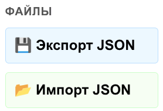

### Кастомизация и мобильная адаптация
* **Смена темы:** Если вас не устраивает светлое оформление, в блоке «Управление холстом» нажмите кнопку **🌓 Сменить тему**.
* **Ориентация экрана (Смартфоны):** При возникновении проблем с отображением принудительно активируйте горизонтальный режим.
* **Установка PWA-приложения:** В меню Chrome (где находятся кнопки «новая вкладка» и «режим чтения») выберите **«Установить приложение»**. Установленное приложение автоматически зафиксирует корректную ориентацию экрана.

---

## 🗺️ Навигация и базовое управление холстом

После импорта перед вами откроется сеть Петри. Для комфортного взаимодействия используйте следующие жесты и горячие клавиши:

* **Перемещение элементов:** Выберите инструмент **🖱️ Курсор** (горячая клавиша `R` на ПК) и перетащите любой элемент мышкой или пальцем.
* **Перемещение по холсту:** Нажмите на белый фон, зажмите левую кнопку мыши (или палец) и сдвиньте лист в нужную сторону.
* **Масштабирование:** 
  * **На ПК:** Зажмите `Ctrl` и прокручивайте колесико мыши.
  * **На тачпаде / смартфоне:** Используйте жест сведения и разведения пальцев (pinch-to-zoom).

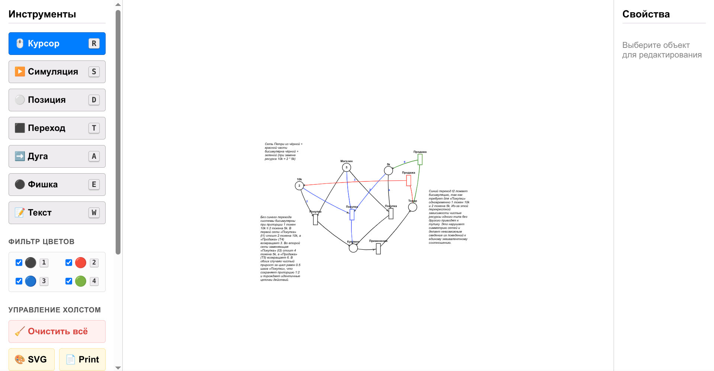

---

## 🛠️ Создание и редактирование элементов сети

Приблизьте холст до комфортного размера и используйте панель инструментов:

### 1. Добавление Позиций и Переходов
* Выберите инструмент **⚪ Позиция** или **⬛ Переход**.
* Кликните на пустое место холста, чтобы создать элемент.
* Чтобы переместить созданный элемент, кликните на него еще раз в этом же режиме и перетащите.

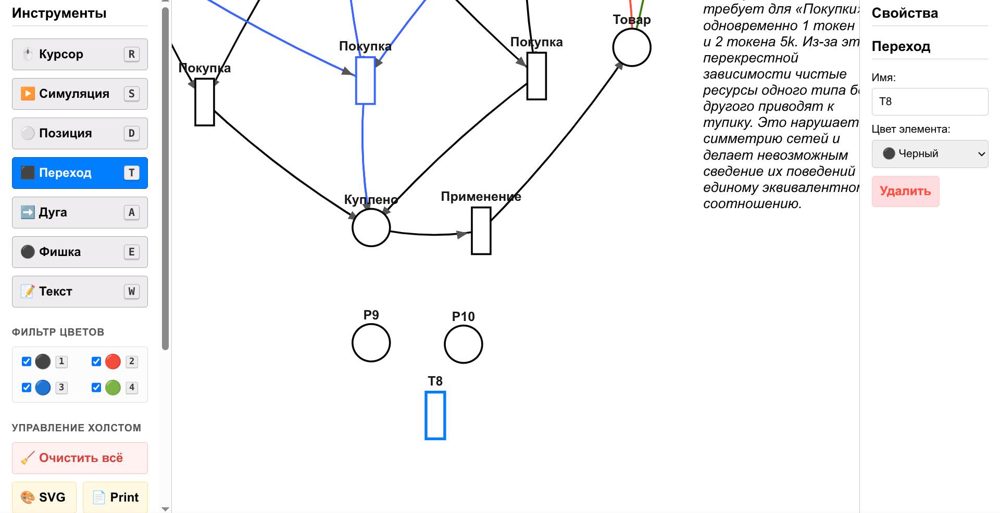

### 2. Соединение дугами
Выберите инструмент **➡️ Дуга**. Соединить элементы можно двумя способами:
* **По клику:** Сначала нажмите на исходный элемент, затем на конечный.
* **Перетаскиванием (быстрый способ):** Зажмите исходный элемент и, не отпуская курсор/палец, натяните дугу до конечного элемента.

*Примечание:* Вы можете создавать две дуги, ведущие к одинаковым вершинам как в одном, так и в разных направлениях.

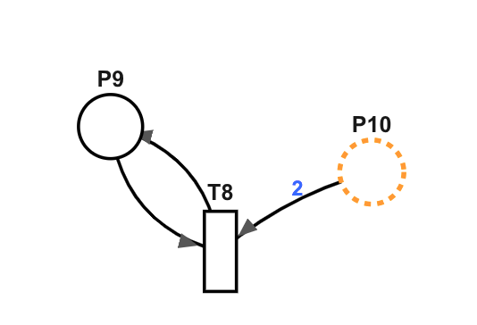

### 3. Разметка фишек и добавление аннотаций
* **Фишки:** Выберите инструмент **⚫ Фишка** и кликните по позиции, чтобы добавить в неё маркер.
* **Текстовые описания:** Выберите инструмент **📝 Текст**, кликните на свободную область рядом с сетью и добавьте текстовое описание вашей модели.

*Удобство:* В режимах «Дуга» и «Фишка» вы можете свободно перемещаться по полю, зажимая и перетягивая холст за пустое место.

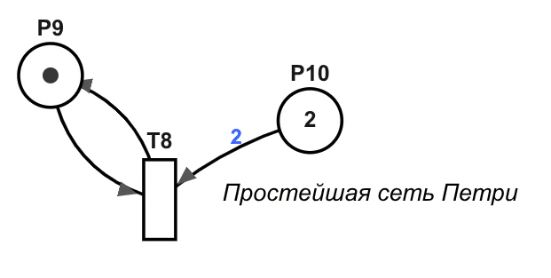

---

## 🎮 Режим симуляции

Для запуска симуляции нажмите на соответствующий инструмент (горячая клавиша `S` на ПК).

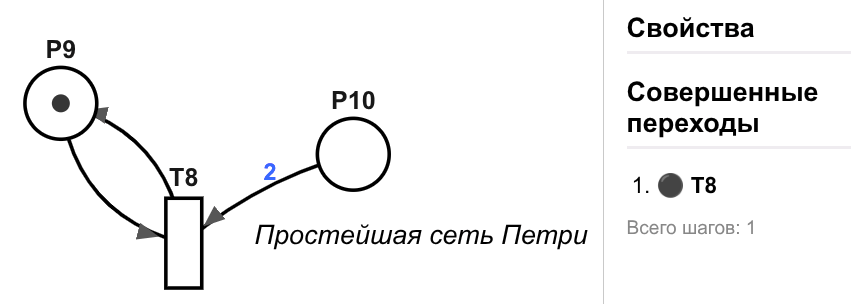

### Управление процессами симуляции
* **Активация переходов:** Кликните по активному переходу (он подсвечивается зеленым цветом). Лог симуляции начнет отображаться в панели справа.
* **Откат шагов (История):** Вы можете перемещаться по истории срабатываний кнопками «Назад» и «Вперед».
  * Горячие клавиши: `Ctrl + Z` — назад; `Ctrl + Y` или `Ctrl + Shift + Z` — вперед (На Mac OS используется клавиша `Cmd`).
  * *Внимание:* Хоткеи могут не работать, если раскладка клавиатуры отлична от английской.
* **Управление разметкой:**
  * **Сбросить к начальной:** Возвращает сеть к стартовому состоянию. Сброс также происходит автоматически при выходе из режима симуляции.
  * **Перезаписать начальную разметку:** Кнопка фиксирует текущее состояние симуляции в качестве новой базовой разметки сети.
* **Ручное изменение в симуляции:** Вы можете кликнуть на позицию прямо во время симуляции и изменить количество фишек вручную. Эти изменения также можно откатывать кнопками «Назад»/«Вперед». Повторное нажатие кнопки «Симуляция» (`S`) возвращает лог.

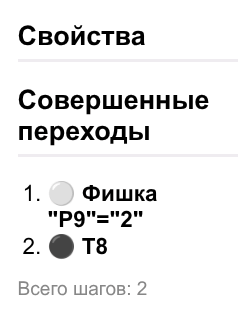

---

## 🎨 Работа с цветом и структурой (Слои)

Цветовое кодирование позволяет разделять сеть на независимые слои и временно менять структуру модели.

### Настройка цвета
1. Выйдите из режима симуляции.
2. Выделите позицию и выберите «синий» цвет в панели (или нажмите `Ctrl + 3`).
3. Покрасьте дугу, связывающую эту позицию с переходом, в тот же цвет.

### Фильтрация цветов в симуляции
Запустите симуляцию и активируйте переходы. В «фильтре цветов» нажмите на синий цвет (или клавишу `3` на клавиатуре). Синяя часть сети скроется, изменив её текущую структуру.

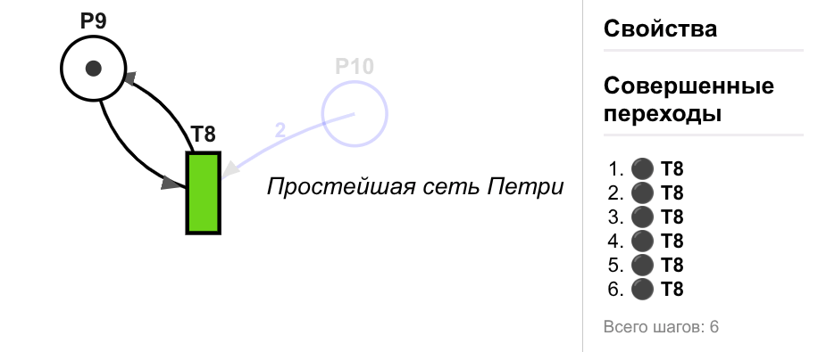

* Кнопка «Назад» работает корректно и последовательно вне зависимости от того, какие цвета скрыты в данный момент.
* Скрытие любого цвета (скройте черный цвет кликом в фильтре или клавишей `1`) скрывает историю симуляции. Это сделано для удобства одновременного тестирования двух разноцветных сетей, расположенных на независимых слоях.

> ⚠️ **Важная теоретическая заметка о скрытии дуг:**
> При разной конфигурации включенных цветов важно помнить: если у перехода скрыта часть дуг, его математическая сущность меняется. Переход, имеющий видимые дуги к одним позициям, и тот же самый переход, имеющий другие видимые дуги к другим позициям — это **два разных перехода** (так как переход определяется как пара мультимножеств позиций, и в данных слоях эти пары различаются). В интерфейсе они должны восприниматься как разные, но называться одинаково.

---

## 🔄 Копирование, удаление и бисимуляция

### Бисимуляция сетей
Имена переходов используются для создания размеченных сетей Петри и позволяют судить о бисимуляции систем:
1. Выделите переход и переименуйте его.
2. Скопируйте его через `Ctrl + C`, а затем вставьте через `Ctrl + V`.
3. Запустите симуляцию, скройте синий цвет и активируйте переходы для проверки логики работы.

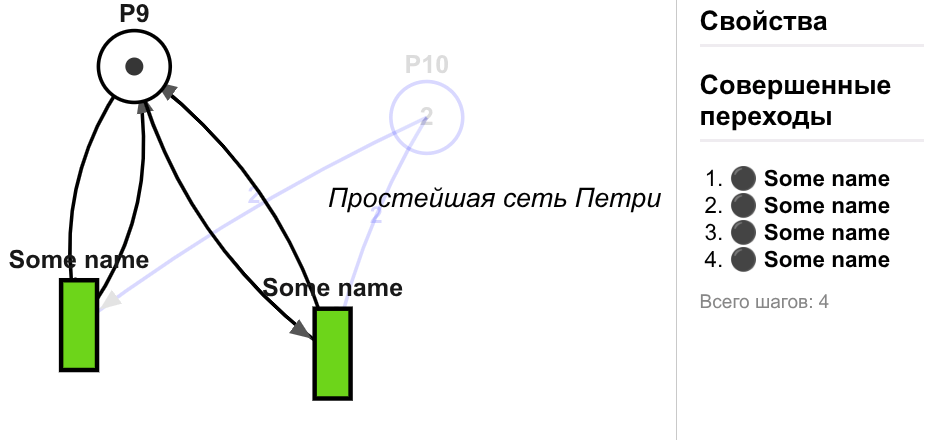

### Удаление объектов
Чтобы удалить переход-двойник или любой другой элемент холста, выделите его и нажмите кнопку удаления на панели либо клавиши `Backspace` / `Delete` на клавиатуре.

---

## 📊 Блок анализа (В разработке)

### Analysis TBD
> В текущий момент серверная часть отключена. Доступен полнофункциональный клиентский редактор, инструменты расширенного анализа сетей Петри будут добавлены в будущих обновлениях.

---

## 🤖 Интеграция с ИИ для оптимизации работы

Вместо перегрузки интерфейса сложными инструментами массового редактирования, для рутинных операций рекомендуется использовать внешних ИИ-помощников.

### Сценарий очистки и оптимизации JSON
1. Экспортируйте созданную сеть Петри в файл `simple-petri-net.json`.
2. Загрузите файл в ваш любимый ИИ-помощник.
3. Отправьте промпт: *«Убери всё, что не относится к структуре моей только что созданной сети Петри, и выдай мне чистый, готовый JSON»*.

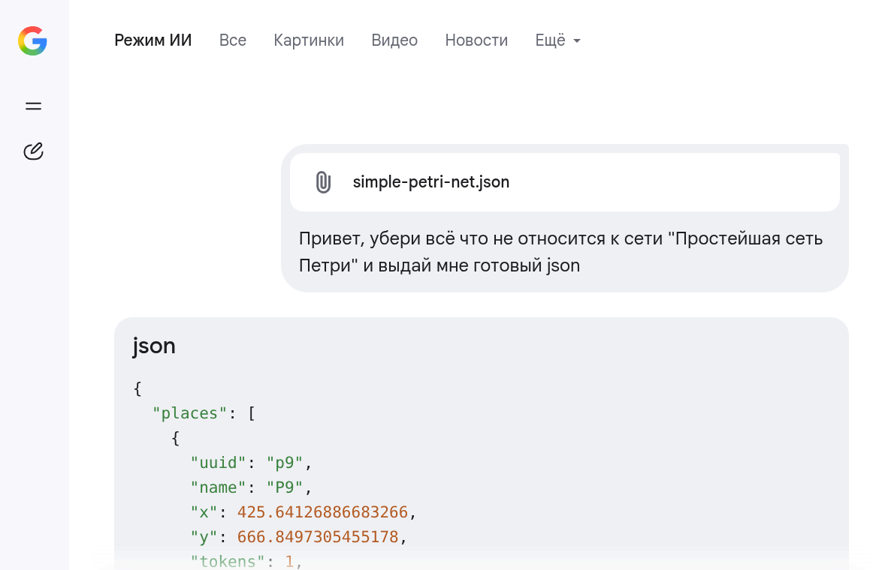

4. Скопируйте полученную структуру и вставьте её в файл `simple-petri-net.json` через любой текстовый редактор.
5. Перетащите обновленный файл на холст браузера или загрузите через кнопку **«Импорт JSON»** для получения корректного результата.

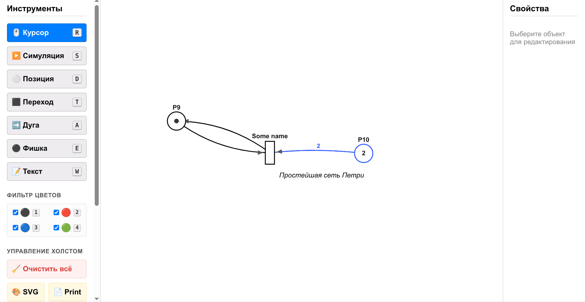

---

## 📝 Заключение

Данный редактор обладает достаточным количеством функций для удобной работы на любом устройстве. При этом он минималистичен и весьма прост в использовании, оставаясь при этом удобным. Каждый инструмент добавлялся, тестировался и закреплялся, основываясь на пользовательском опыте использования с ноутбука и мобильного телефона, поэтому так важно не нарушить текущее удобство работы с данным приложением.
